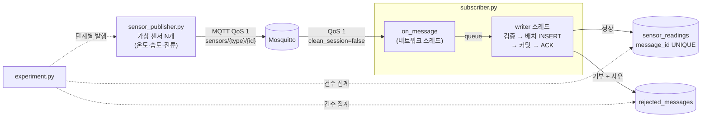

# sensor-data-pipeline

설비 센서 데이터를 **MQTT로 수집 → 검증 → MSSQL에 저장**하는 최소 파이프라인입니다.
"데이터가 빠지거나 중복되지 않고 저장되는가"를 **실험으로 증명**하는 데 초점을 맞췄습니다.

## 목적

- 현장 설비 데이터 수집에서 흔한 문제(필드 누락, 중복 전송, 잘못된 값)를 재현하고 걸러낸다.
- 전송량을 늘려가며 **유실 0건 / 저장·거부 건수 정확도**를 수치로 확인한다.
- 각 설계 선택의 이유를 남긴다 → [docs/design-decisions.md](docs/design-decisions.md)

## 아키텍처



핵심 흐름: **QoS 1(최소 1회 전달) + message_id 유니크 제약(멱등 저장) + DB 커밋 후 ACK** → 유실 없이, 중복 없이 저장.

## 폴더 구조

```
docker-compose.yml        Mosquitto + MSSQL 2022
mosquitto/mosquitto.conf  브로커 설정 (큐 한도 확장)
db/init.sql               DB·테이블·인덱스 (재실행 안전)
config.py                 접속 정보 (.env)
validator.py              검증 규칙 (순수 함수)
db.py                     DB 연결·집계 헬퍼
init_db.py                init.sql 실행
sensor_publisher.py       가상 센서 발행기
subscriber.py             구독 → 검증 → 배치 저장
experiment.py             단계별 부하 실험
tests/test_validator.py   검증 규칙 단위 테스트
results/                  실험 결과 CSV
docs/design-decisions.md  설계 결정 이유
```

## 실행 방법 (Windows PowerShell)

```powershell
# 1) 인프라
copy .env.example .env
docker compose up -d --wait            # 두 컨테이너가 healthy가 될 때까지 대기

# 2) Python 환경
py -3.12 -m venv .venv
.venv\Scripts\activate
pip install -r requirements.txt

# 3) DB 초기화 + 테스트
python init_db.py                      # 테이블/인덱스 목록 출력
pytest -q

# 4) 수동 실행 (터미널 2개)
python subscriber.py                   # 터미널 1
python sensor_publisher.py --sensors 6 --interval 1 --count 100 --anomaly-rate 0.1   # 터미널 2

# 5) 부하 실험 (subscriber를 자동으로 띄우므로, 4)의 subscriber는 먼저 종료)
python experiment.py                   # 기본: 1천 / 1만 / 5만 건
```

### 발행기 옵션

| 옵션 | 기본값 | 설명 |
|---|---|---|
| `--sensors` | 6 | 센서 수 (temp / hum / cur 순서로 배정) |
| `--interval` | 1.0 | 라운드(센서 전체 1회 전송) 간격(초), 0이면 최대 속도 |
| `--count` | 100 | 총 전송 건수 |
| `--anomaly-rate` | 0.05 | 이상 데이터 비율. 누락/중복/타입오류/범위초과를 균등 배분 |
| `--seed` | 없음 | 난수 시드 (같은 값이면 같은 데이터 → 재현 가능) |

## 검증 규칙

검사 순서대로 첫 번째로 걸린 사유 하나만 기록합니다.

| 사유 | 조건 | 처리 위치 |
|---|---|---|
| `invalid_json` | JSON 파싱 실패, 객체가 아님 | validator |
| `missing_field` | `message_id`, `sensor_id`, `value`, `timestamp` 중 누락 또는 null | validator |
| `invalid_type` | value가 숫자가 아님(bool·NaN·Infinity 포함), timestamp가 ISO 8601이 아니거나 시간대 없음 | validator |
| `unknown_sensor` | sensor_id 접두어가 `temp`/`hum`/`cur`가 아님 | validator |
| `out_of_range` | 온도 −40~125 ℃, 습도 0~100 %, 전류 0~50 A 밖 | validator |
| `duplicate` | 이미 받은 message_id | subscriber (배치 내) + DB 유니크 제약 (배치 간) |

거부된 메시지는 **원문(raw_payload)과 함께** 저장해 원인 분석·재처리가 가능합니다.

## 실험 결과

환경: Windows 11, Docker Desktop(WSL2, 8 GB), 모든 구성요소 로컬 실행 / 센서 30개, 이상 데이터 5 %, seed 42, 배치 500건·0.5초

| 전송 | 저장 | 거부 | 유실 | 기대 저장 | 정확 | 발행 시간(s) | 전체 처리 시간(s) | 초당 처리량 |
|---:|---:|---:|---:|---:|:---:|---:|---:|---:|
| 1,000 | 955 | 45 | **0** | 955 | ✅ | 0.35 | 0.65 | 1,530 |
| 10,000 | 9,497 | 503 | **0** | 9,497 | ✅ | 5.63 | 6.21 | 1,609 |
| 50,000 | 47,495 | 2,505 | **0** | 47,495 | ✅ | 24.64 | 33.07 | 1,512 |

- **유실** = 전송 − (저장 + 거부). 모든 메시지는 둘 중 한 테이블에 반드시 들어가야 하므로 0이면 파이프라인에서 빠진 데이터가 없다는 뜻입니다.
- **정확** = 저장 건수와 사유별 거부 건수가 발행기가 의도한 건수와 모두 일치.
- **전체 처리 시간** = 첫 발행부터 마지막 메시지가 DB에 반영될 때까지.
- 원본: [results/experiment_results.csv](results/experiment_results.csv)

### 실험 중 발견한 것

**1. 중복 몇 건이 처리량을 1/3로 떨어뜨림 → 배치 내 중복 선제거로 3.6배 개선**

처음 구현은 "다건 INSERT → 유니크 위반 시 그 배치만 1건씩 재시도"였습니다.
중복률 1.25 %여도 500건 배치에는 평균 6건이 섞여 **거의 모든 배치가 느린 경로**를 탔습니다.

| 조건 (5만 건) | 전체 처리 시간 | 초당 처리량 |
|---|---:|---:|
| 개선 전 (이상 데이터 5 %) | 117.7 s | 425 |
| 개선 전, 이상 데이터 0 % (1만 건, 원인 확인용) | — | 1,830 |
| **개선 후** (배치 내 중복을 메모리에서 먼저 제거) | **33.1 s** | **1,512** |

배치 간 중복은 여전히 DB 유니크 제약이 최종적으로 막습니다 → 정확성은 그대로, 느린 경로만 드물어짐.

**2. QoS 1이어도 브로커 큐가 넘치면 유실된다**

Mosquitto 기본값 `max_queued_messages 1000`으로 5만 건을 보내면:

| 설정 | 전송 | 저장+거부 | 유실 |
|---|---:|---:|---:|
| 기본값 1000 | 50,000 | 34,743 | **15,257 (30.5 %)** |
| 200000 (현재) | 50,000 | 50,000 | **0** |

구독자가 발행 속도를 못 따라가는 순간 브로커가 메시지를 버립니다. QoS는 "전송 구간"의 보장일 뿐,
**브로커 자원 한도까지 포함해야 end-to-end 보장**이 됩니다. 원본: [results/compare_broker_queue_1000.csv](results/compare_broker_queue_1000.csv)

**3. 전송 도중 구독자를 강제 종료해도 유실 0건**

2만 건 전송 중 4초 시점에 subscriber 프로세스를 `kill`(정리 코드 실행 없이 종료) → 3초 후 재시작.

| 종료 시점 DB 반영 | 전송 | 저장 | 거부 | 유실 | 정확 |
|---:|---:|---:|---:|---:|:---:|
| 5,842 | 20,000 | 18,983 | 1,017 | **0** | ✅ |

커밋 전 메시지는 ACK되지 않았으므로 `clean_session=false` 세션에 남아 있다가 재접속 시 재전달됐습니다.
(커밋 직후·ACK 직전에 죽으면 같은 메시지가 재전달될 수 있지만, 그때는 유니크 제약이 `duplicate`로 걸러냅니다.)

## 한계

- **브로커 영속성 없음**: Mosquitto `persistence`가 꺼져 있어 브로커가 재시작되면 큐의 메시지가 사라집니다.
- **구독자 1개**: 수평 확장(shared subscription) 미적용. 처리량은 단일 프로세스 기준입니다.
- **배치 간 중복이 많으면 느려짐**: 1건씩 재시도 경로를 타기 때문. 스테이징 테이블 + `INSERT ... WHERE NOT EXISTS` 방식으로 개선 가능.
- **같은 message_id, 다른 내용**은 구분하지 않고 먼저 온 것을 저장합니다.
- **보안 미적용**: MQTT 익명 접속, TLS 없음, DB `sa` 계정 사용 (로컬 데모 전제).
- **단일 PC 측정**: 발행기·브로커·DB가 같은 PC에서 자원을 나눠 써서 절대 수치는 환경 의존적이며, 현재는 Python 발행기 속도가 상한입니다.
- 값 하나하나의 범위만 검사하며, 급변(spike)·장시간 고정값 같은 **시계열 이상**은 탐지하지 않습니다.

## 다음 단계

1. **조회 API** (FastAPI): `GET /sensors/{id}/readings?from=&to=` → `(sensor_id, measured_at)` 인덱스 활용, `GET /rejections?reason=` 거부 현황
2. **대시보드** (Grafana + MSSQL 데이터소스): 센서별 추이, 거부 사유 비율, 수집 지연(`received_at − measured_at`)
3. Mosquitto persistence 활성화, 구독자 수평 확장(`$share/` 구독), 장애 주입 실험(구독자·DB 강제 종료 중 유실 여부)
