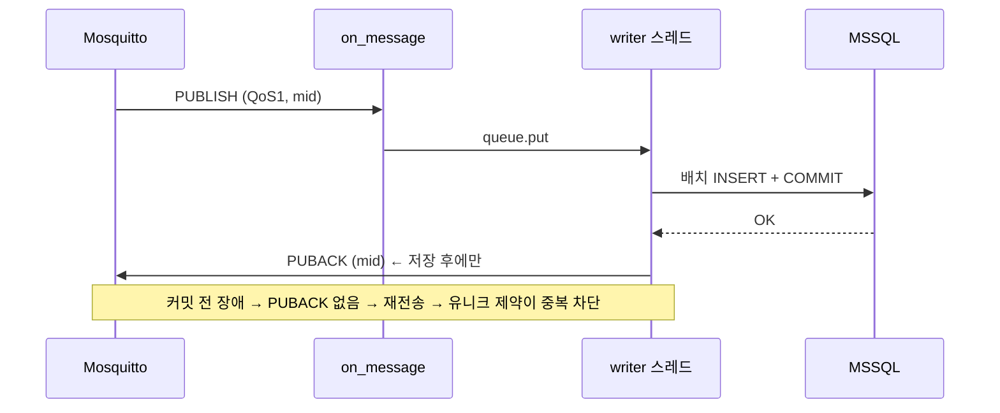

# 설계 결정 기록

각 항목: **결정 → 대안 → 이유 → 감수한 점**

---

## 1. MQTT QoS 1

- **결정**: 발행·구독 모두 QoS 1 (at-least-once, 최소 1회 전달)
- **대안**
  - QoS 0 (최대 1회): 가장 빠르지만 네트워크·브로커 문제 시 조용히 유실
  - QoS 2 (정확히 1회): 메시지당 4-way 핸드셰이크로 느리고, 보장 범위도 "클라이언트↔브로커 구간"뿐이라 DB 저장까지 보장하지는 않음
- **이유**: 설비 데이터는 유실이 중복보다 치명적. 중복은 DB에서 싸게 제거할 수 있으므로
  **"전달은 QoS 1, 중복 제거는 DB"**로 역할을 나눔 → 결과적으로 저장은 정확히 1건
- **감수한 점**: 중복이 실제로 발생하므로 저장 계층이 반드시 멱등(idempotent)해야 함 → 2번

## 2. 중복 처리: message_id 유니크 제약 (+ 배치 내 선제거)

- **결정**: `sensor_readings.message_id`에 `UNIQUE` 제약. 같은 배치 안의 중복은 INSERT 전에 Python `set`으로 먼저 제거
- **대안**
  - 애플리케이션에서 `SELECT`로 존재 확인 후 INSERT: 동시 처리 시 둘 다 통과하는 경쟁 조건(race condition)
  - `IGNORE_DUP_KEY = ON` 인덱스: 간단하지만 중복을 조용히 버려 **몇 건이 중복이었는지 기록 불가**
  - Redis 등 외부 캐시로 중복 체크: 구성요소 증가, 캐시와 DB 불일치 가능
- **이유**: DB 제약은 원자적이라 구독자가 여러 개여도 깨지지 않는 **최종 방어선**.
  중복을 `rejected_messages`에 `duplicate` 사유로 남겨 "전송 = 저장 + 거부" 회계가 맞아떨어짐
- **실험으로 바꾼 부분**: 처음엔 유니크 위반 시 배치 전체를 1건씩 재시도했는데,
  중복률 1.25 %만으로 거의 모든 배치가 느린 경로를 타서 처리량이 425건/초로 떨어짐.
  배치 내 중복 선제거 후 1,512건/초 (README 실험 결과 참고)

## 3. 배치 저장

- **결정**: 500건 또는 0.5초 중 먼저 도달하는 쪽에서 다건 `INSERT ... VALUES (...),(...)` + 커밋 1회
- **대안**: 메시지마다 INSERT + 커밋 → 구현은 단순하지만 DB 왕복·커밋(로그 flush)이 건수만큼 발생
- **이유**: 왕복·커밋 횟수를 1/500로 줄임. 시간 조건(0.5초)을 함께 둬서 트래픽이 적을 때도 지연이 0.5초를 넘지 않음
- **세부**: SQL Server는 쿼리당 파라미터 2100개 제한 → 행당 5개 파라미터이므로 400행씩 나눠 실행
- **감수한 점**: 최대 0.5초의 저장 지연. 실시간 제어가 아닌 수집·이력 목적이라 허용 가능

## 4. DB 커밋 후 ACK (수동 ACK)

- **결정**: paho `manual_ack=True`, 배치 커밋이 끝난 뒤에 해당 메시지들의 PUBACK 전송. 구독은 `clean_session=False`
- **대안**: 기본 자동 ACK → 수신 즉시 ACK되므로, 메모리 큐에 있는 동안 구독자가 죽으면 유실
- **이유**: ACK의 의미를 "받았다"에서 **"DB에 저장했다"**로 바꿔 end-to-end at-least-once 보장.
  DB 장애 시에도 ACK하지 않고 재시도하므로 브로커가 메시지를 보관
- **감수한 점**: ACK 대기 메시지가 많아짐 → 브로커 `max_inflight_messages`를 배치 크기보다 크게(1000) 설정해야 막히지 않음

## 5. 수신 스레드와 저장 스레드 분리

- **결정**: `on_message`는 큐에 넣기만 하고, 검증·저장은 별도 writer 스레드
- **이유**: 콜백에서 DB를 기다리면 MQTT 네트워크 루프가 멈춰 keepalive 끊김·수신 지연 발생. 큐가 완충 역할
- **감수한 점**: 큐가 메모리에 있음 → 4번(커밋 후 ACK)으로 유실 위험 보완

## 6. 브로커 큐 한도

- **결정**: `max_queued_messages 200000` (기본 1000)
- **이유**: 실험 결과 기본값에서 5만 건 전송 시 **30.5 % 유실**. QoS 1이어도 브로커가 큐 한도를 넘으면 버림
- **감수한 점**: 브로커 메모리 사용 증가. 운영에서는 한도를 무한정 늘리기보다 구독자 확장(shared subscription)과 모니터링이 정답

## 7. 검증 위치와 순서

- **결정**: 구독자에서 검증(브로커는 단순 전달). `validator.py`를 DB·MQTT와 무관한 순수 함수로 분리
- **순서**: JSON 파싱 → 필드 누락 → 타입 → 센서 종류 → 범위 (앞 단계가 통과해야 뒤 검사가 의미 있음)
- **세부 판단**
  - Python에서 `True`는 `int`의 하위 타입, `json.loads`는 `NaN`을 허용 → 둘 다 명시적으로 거부
  - 시간대 없는 timestamp 거부, 저장은 UTC로 통일 (설비마다 시계 기준이 다를 수 있음)
  - 거부 데이터도 원문 보존 → 규칙이 잘못됐을 때 재처리 가능

## 8. 기타

- **pymssql 선택**: pyodbc는 Microsoft ODBC Driver 18 별도 설치가 필요. pymssql은 pip만으로 동작해 재현성이 좋음
- **init.sql 재실행 안전**: `IF ... IS NULL` 패턴으로 여러 번 실행해도 에러 없음
- **message_id = `{run_id}-{순번}`**: 유실 시 몇 번이 빠졌는지 추적 가능
